# Lattice — Graph-RAG chat over a Neo4j policy knowledge graph

**▶ Live demo:** https://aptsalt.github.io/lattice/

A world-class **Angular 21** chat UI for a **hybrid Graph-RAG** assistant. The
domain is HR leave policy modelled as a knowledge graph — **World → North
America → United States / Mexico / Canada** — so every answer is composed only
from graph facts and policy passages, cited by section, with the retrieved
**subgraph shown interactively in four switchable views**.

The production system is Angular → FastAPI → Neo4j. This repository ships the
Angular tier with an in-browser engine that runs the same eight-stage pipeline
and returns the same `POST /chat` contract, so the demo runs on GitHub Pages
with no backend and the real service can be dropped in behind one method.


▶ Full 72-second tour as video: [docs/tour.mp4](docs/tour.mp4) (composer controls → cited answer → sources → Force / Radial / Orbit / Replay → facts, Cypher, trace → context follow-up → comparison → LLM off → light theme → architecture)

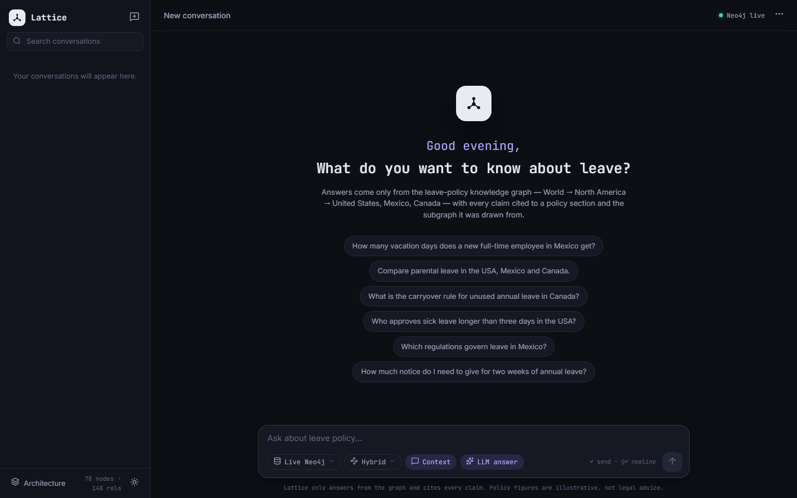

## What it does

| | |
|---|---|
| 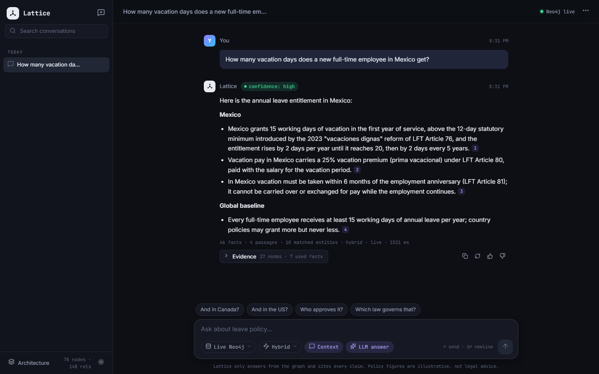 | 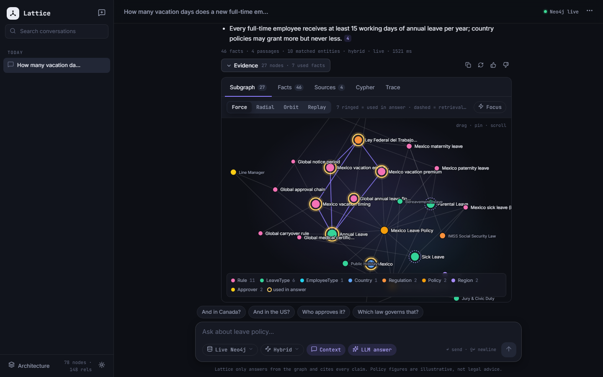 |
| Grounded answer with `[n]` citations, confidence badge and retrieval stats | Evidence → Subgraph (Force): ring = used in answer, dashed = retrieval seed |
| 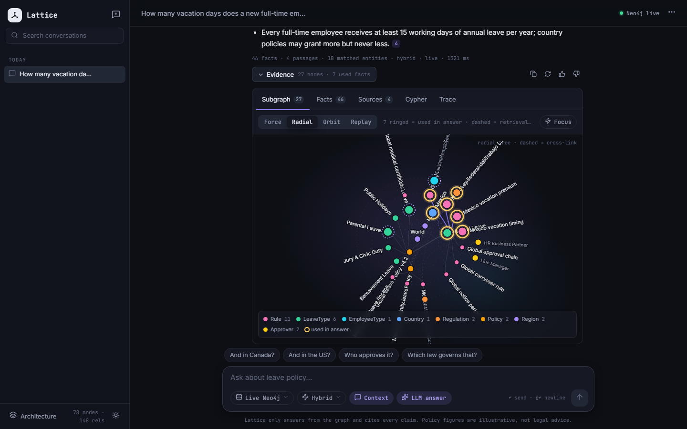 | 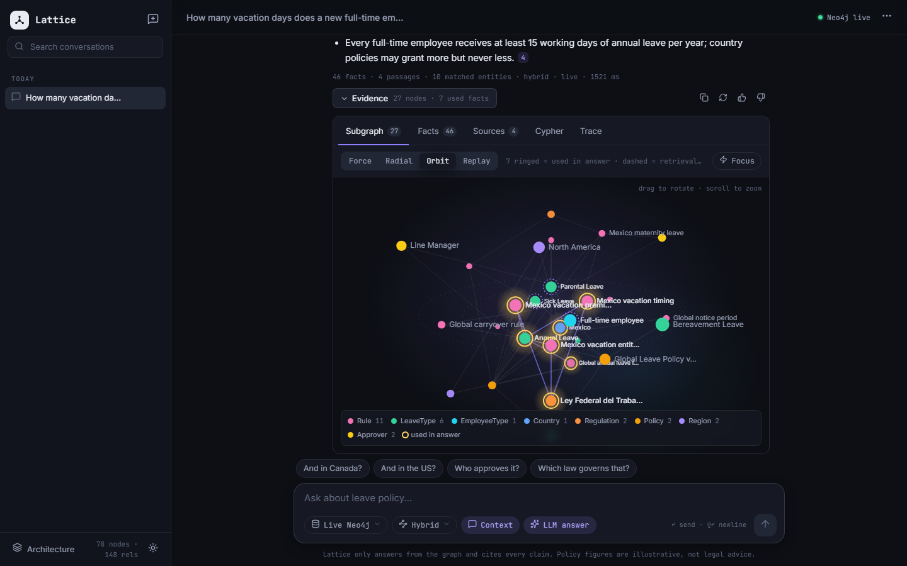 |
| Radial taxonomy tree: World → country → policy → leave type → rule | Orbit: 3D canvas projection, depth, glow, slow rotation |
| 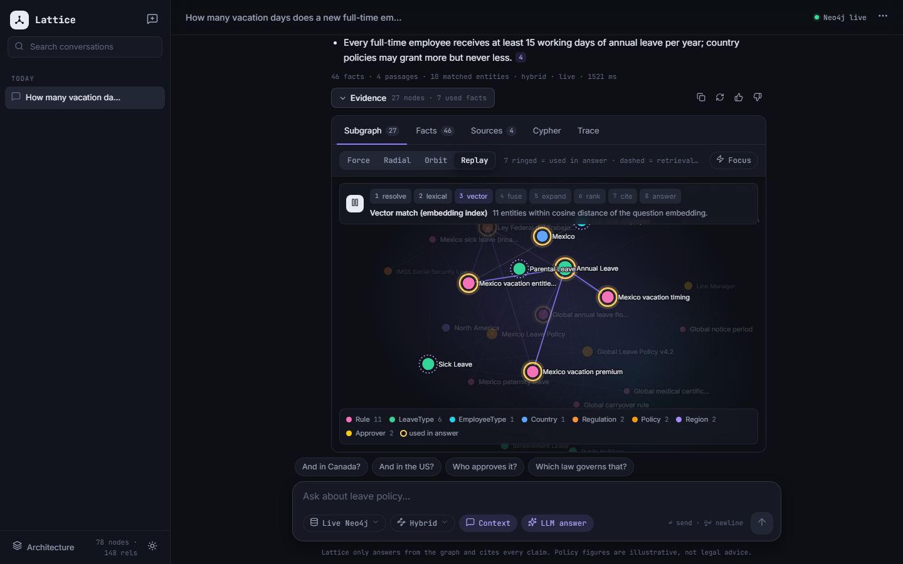 | 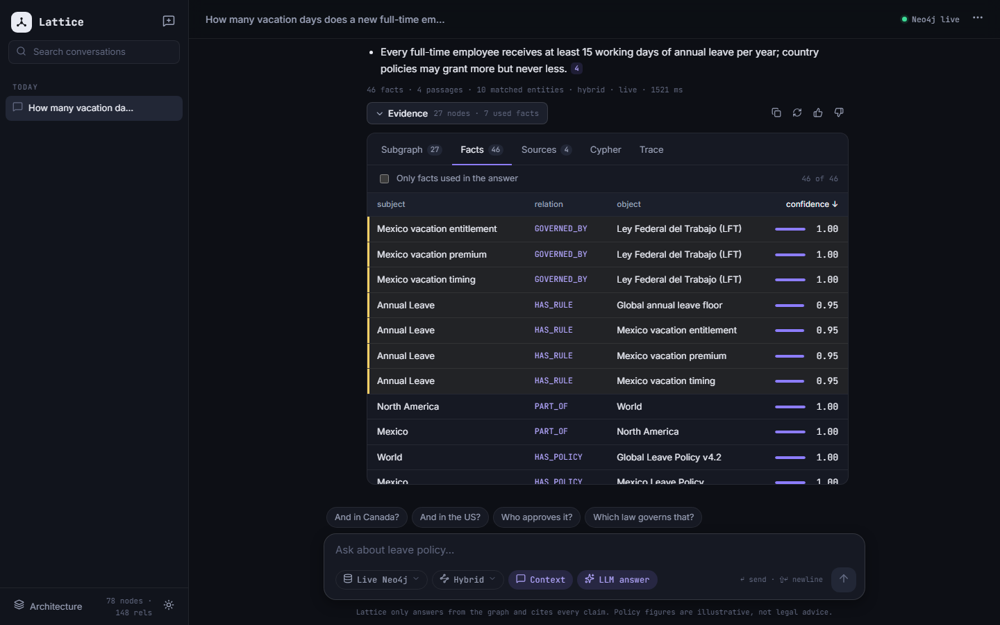 |
| Replay: the retrieval pipeline animated step by step on the graph | Facts: subject · relation · object · confidence, used facts first |
| 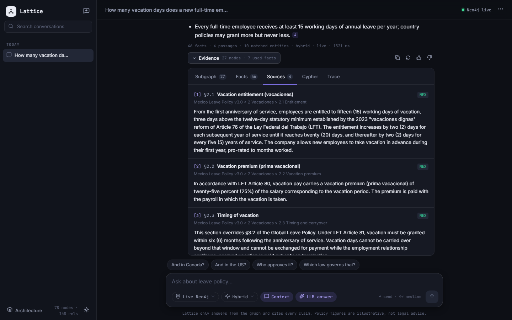 | 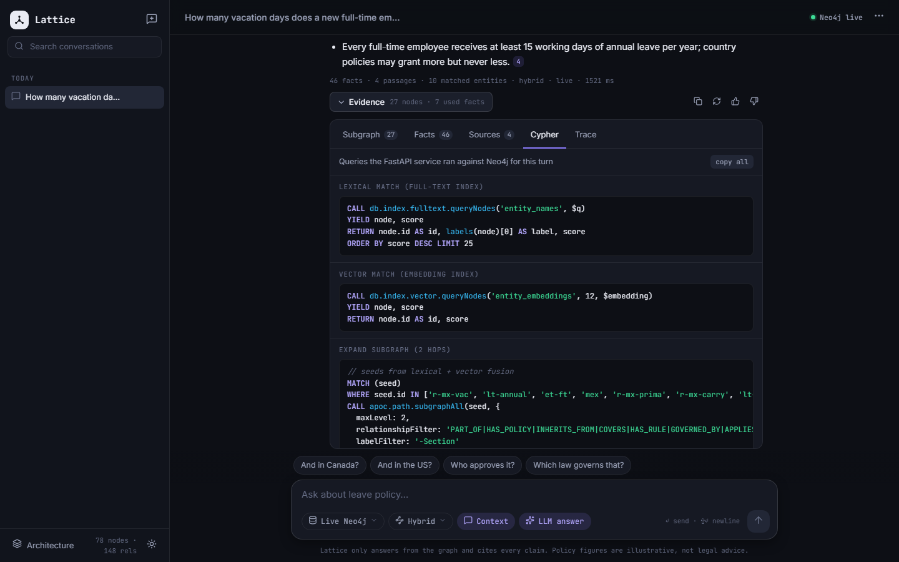 |
| Sources: cited passages with document breadcrumbs | Cypher: the exact queries the service ran for this turn |
| 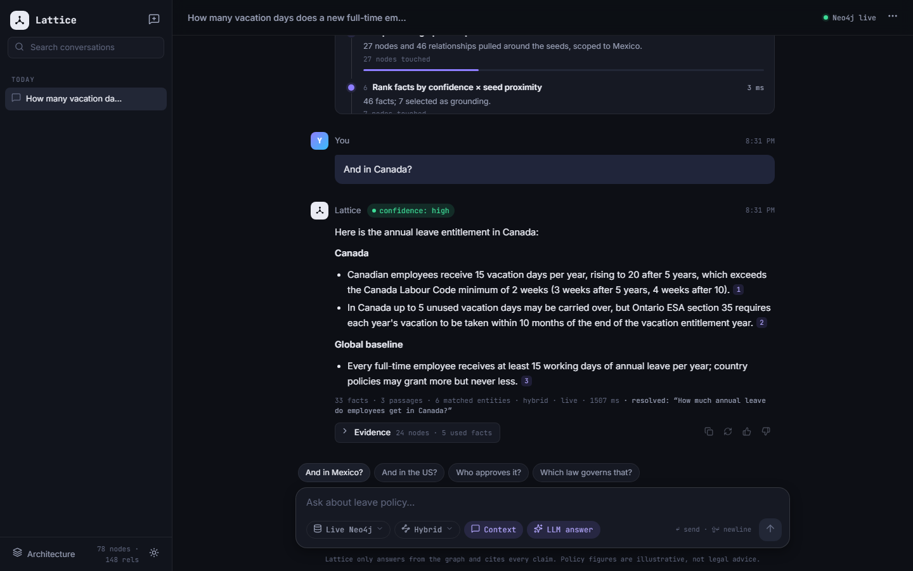 | 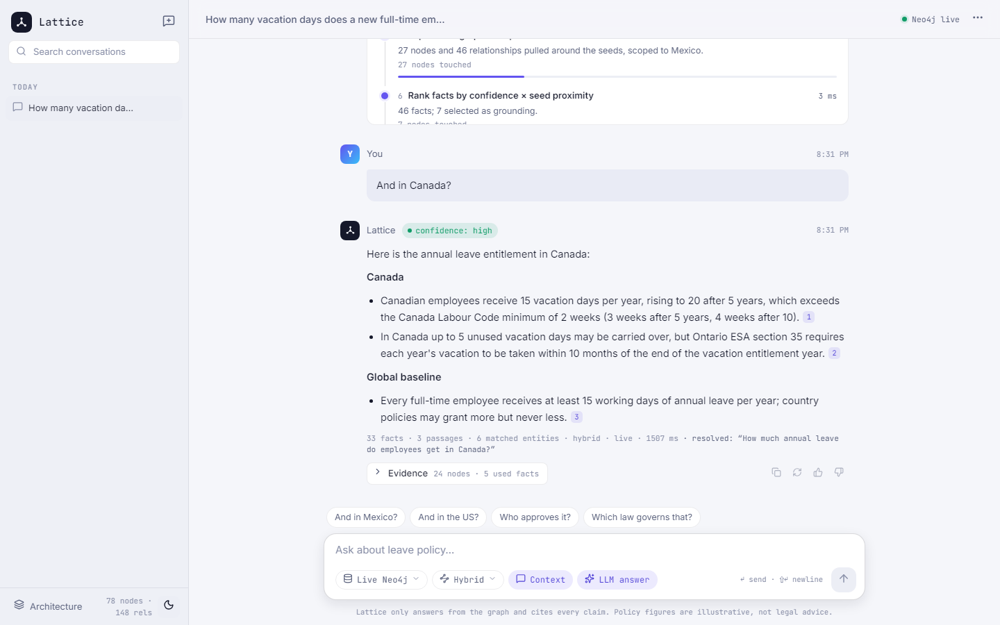 |
| Conversation context: "And in Canada?" is resolved against the last turn | Light theme |
| 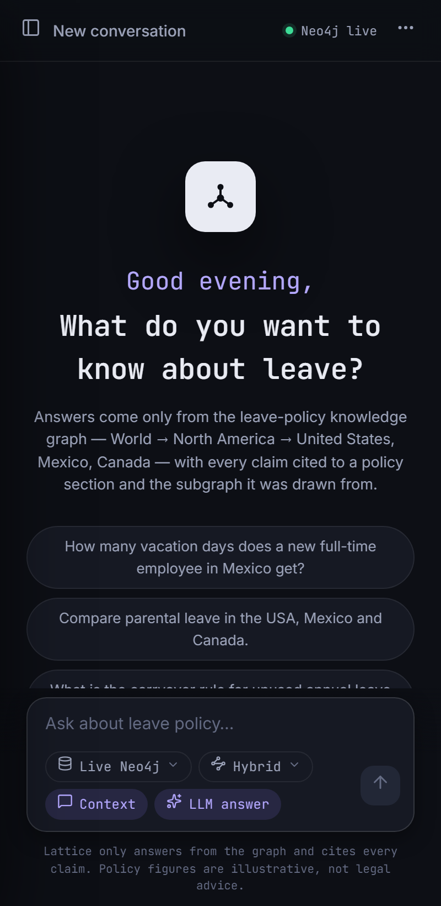 | 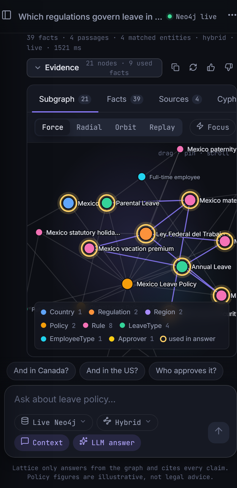 |
| Phone width: conversations become a drawer, controls wrap in the composer | The evidence graph at 400px |

### Feature parity with the Streamlit version, re-homed

The Streamlit prototype kept every switch in a left settings panel. Here the
**left panel is conversations only** and every control lives in the composer:

| Control | Where it lives now |
|---|---|
| Data source — Live Neo4j / Offline `resolved.json` | Composer pill with popover |
| Retrieval mode — lexical / vector / hybrid / graph | Composer pill with popover |
| Use conversation context | Composer toggle chip |
| Generate LLM answer (off = extractive facts) | Composer toggle chip |
| Clear conversation | Conversation menu (⋯) |
| Suggested questions | Hero chips on the empty state; follow-up chips after each answer |
| `confidence: high` badge, stats line | Under every answer |
| Evidence → Subgraph / Facts / Sources | Evidence → **Subgraph (4 views) / Facts / Sources / Cypher / Trace** |

## The hybrid Graph-RAG pipeline

```
question ─► resolve ─► lexical ─┐
                                ├─► fuse (RRF) ─► expand (Cypher, 2–3 hops) ─► rank ─► cite ─► answer
                     vector ────┘
```

| # | Stage | What happens | In Neo4j / FastAPI |
|---|---|---|---|
| 1 | Resolve | Follow-ups ("and in Canada?") are rewritten with the previous turn's country, leave type and facet | rule-based coreference (or a small LLM call) |
| 2 | Lexical | Full-text match on entity names and aliases | `db.index.fulltext.queryNodes` |
| 3 | Vector | Question embedding against entity and passage embeddings | `db.index.vector.queryNodes` |
| 4 | Fuse | Reciprocal-rank fusion, k = 60 (hybrid); either list alone in lexical/vector mode | Python |
| 5 | Expand | 2-hop traversal from the seeds (3 hops in graph mode), scoped to the countries in the question | `apoc.path.subgraphAll` with label/relationship filters |
| 6 | Rank | Facts scored by confidence × seed proximity; rules the answer may rely on are selected | Python |
| 7 | Cite | Passages the selected rules were extracted from | `(:Rule)-[:CITED_IN]->(:Section)` |
| 8 | Answer | LLM writes only from the supplied facts and passages; every claim carries a `[n]` section citation. With the LLM off, the facts are returned verbatim | Gemini / Claude + citation validator |

Every stage is timed and emits the node ids it touched. That trace drives the
**Trace** tab, the **Cypher** tab and the **Replay** graph view.

### Graph schema

```
(:Region)-[:PART_OF]->(:Region)               North America → World
(:Country)-[:PART_OF]->(:Region)              USA / MEX / CAN → North America
(:Country)-[:HAS_POLICY]->(:Policy)
(:Policy)-[:INHERITS_FROM]->(:Policy)         country policy → Global Leave Policy v4.2
(:Policy)-[:COVERS]->(:LeaveType)             annual · sick · parental · bereavement · holidays · jury
(:LeaveType)-[:HAS_RULE]->(:Rule)             entitlement · carryover · notice · approval · pay · eligibility
(:Rule)-[:OVERRIDES]->(:Rule)                 a country clause replaces a global clause
(:Rule)-[:GOVERNED_BY]->(:Regulation)         FMLA · LFT · IMSS · Canada Labour Code · Ontario ESA · EI
(:Rule)-[:APPLIES_TO]->(:EmployeeType)
(:Rule)-[:APPROVED_BY]->(:Approver)           Line Manager · HRBP
(:Rule)-[:CITED_IN]->(:Section)               provenance: the passage the fact came from
```

The demo graph has 78 nodes and 148 relationships (`src/app/core/graph-data.ts`),
with 23 policy passages across the global policy and the three country policies.
Figures reference real statutes (FMLA, the 2023 *vacaciones dignas* reform of LFT
Art. 76, Canada Labour Code s.239) but the company rules are illustrative — this
is a demo corpus, not legal advice.

## The four subgraph views

| View | Built with | Why it is here |
|---|---|---|
| **Force** (default) | `d3-force` + SVG | Parity with the Streamlit view, polished: yellow ring = used in answer, dashed ring = retrieval seed, drag to pin, double-click to release, scroll to zoom, hover for properties and relation labels, neighbour highlighting, **Focus** dims everything the answer did not use |
| **Radial** | `d3-hierarchy` | The domain *is* a taxonomy. A radial tree from World outward makes the inheritance chain read at once; edges outside the spanning tree are drawn dashed so nothing is hidden |
| **Orbit** | Canvas 2D, hand-rolled 3D projection | Zero dependencies, inspired by the Claude Code dashboard ecosystem view: seeds at the core, one shell per hop, slow rotation, glow on used nodes, drag to rotate |
| **Replay** | Force layout + timeline | Lights nodes up in the order the pipeline touched them — seeds, expansion, grounding — so the viewer sees *why* the answer is grounded |

All four consume one `Subgraph` view-model (`seed`, `used`, `hop` per node) and
share the tooltip, legend and focus logic in `graph-shared.ts`.

## Modern Angular on display

- **Angular 21**, standalone, **zoneless**, **signals** everywhere (`signal` / `computed` / `effect` / `input()` / `output()` / `viewChild()`), `OnPush` throughout
- New control flow (`@if` / `@for` / `@switch`) and **`@defer`** for every graph view
- `afterNextRender` / `afterRenderEffect` for DOM-bound work (d3, canvas, scroll-follow)
- **Angular CDK** overlay for the composer popovers and the conversation menu
- Hand-rolled design tokens (dark-first, light theme via `data-theme`), no UI kit
- `marked` + `DOMPurify` for answer markdown; citations become focusable `<sup>` buttons
- Lazy routes, hash location (GitHub Pages friendly), localStorage persistence
- Vitest unit tests (engine + store) and a Playwright smoke walk that asserts **0 console errors**

## Run it

```bash
npm install --legacy-peer-deps
npm start                      # http://localhost:4200
npm test -- --watch=false      # Vitest
py -I e2e/walk.py http://localhost:4200     # Playwright walk, writes docs/screenshots
py -I e2e/mobile.py http://localhost:4200   # 400px smoke
py -I e2e/tour.py http://localhost:4200     # records docs/tour.webm
```

## Wire in the real backend

`src/app/core/rag-engine.ts` is the only place that knows the answer comes from
the browser. Replace the body of `RagEngine.chat()` with an `HttpClient` call:

```ts
chat(req: ChatRequest): Promise<ChatResponse> {
  return firstValueFrom(this.http.post<ChatResponse>(`${environment.apiBase}/chat`, req));
}
```

The contract (`src/app/core/models.ts`):

```jsonc
POST /chat
{ "question": "...", "conversationId": "c_01",
  "settings": { "source": "live", "mode": "hybrid", "useContext": true, "generateAnswer": true },
  "history": [ { "role": "user", "text": "..." } ] }

200 OK
{ "resolvedQuestion": "...", "answerMarkdown": "... [1] ...", "confidence": "high",
  "stats": { "facts": 46, "passages": 4, "matchedEntities": 10, "mode": "hybrid", "source": "live", "latencyMs": 612 },
  "facts": [ { "subject", "relation", "object", "confidence", "usedInAnswer", "sectionId" } ],
  "passages": [ { "id", "ref", "title", "breadcrumb", "text", "country" } ],
  "citations": [ { "n": 1, "passageId": "s-ca-22" } ],
  "subgraph": { "nodes": [ { "id", "label", "name", "seed", "used", "hop" } ], "edges": [ { "source", "target", "relation", "confidence", "used" } ] },
  "trace": [ { "id", "title", "detail", "ms", "nodeIds", "cypher" } ],
  "cypher": "MATCH ..." }
```

For streaming, have FastAPI send the `ChatResponse` first as an SSE `meta`
event and then the answer tokens; `ChatStore.send()` already attaches the
response before the prose streams in.

## Project layout

```
src/app/
  core/            models (API contract) · graph-data (the KG) · rag-engine (pipeline) · chat-store · theme · markdown
  features/
    sidebar/       conversations only: new, search, grouped by date, rename, delete
    chat/          hero empty state · thread · composer dock
    composer/      source + mode pills, context + LLM chips, follow-up chips, send
    message/       streamed markdown, citations, confidence, stats, actions, evidence toggle
    evidence/      tabs · graph-force · graph-radial · graph-orbit · graph-trace · facts-table · sources-list · cypher-view · trace-steps
    architecture/  /architecture — the three tiers, the pipeline, the schema, the contract
docs/superpowers/specs/   the design spec this was built against
e2e/walk.py               Playwright smoke walk
```

## Design references

- Visual direction: the SenseAI chatbot platform shot on Dribbble (dark graphite, mono type, floating composer with an icon row, popovers from the composer, avatar-name-time messages with a hover action rail)
- Graph canvas: the ecosystem view of the Claude Code dashboard (nebula background, glow halos, legend card)
- Angular patterns: [aptsalt/meridian](https://github.com/aptsalt/meridian) and [aptsalt/stratum](https://github.com/aptsalt/stratum)

## License

MIT
